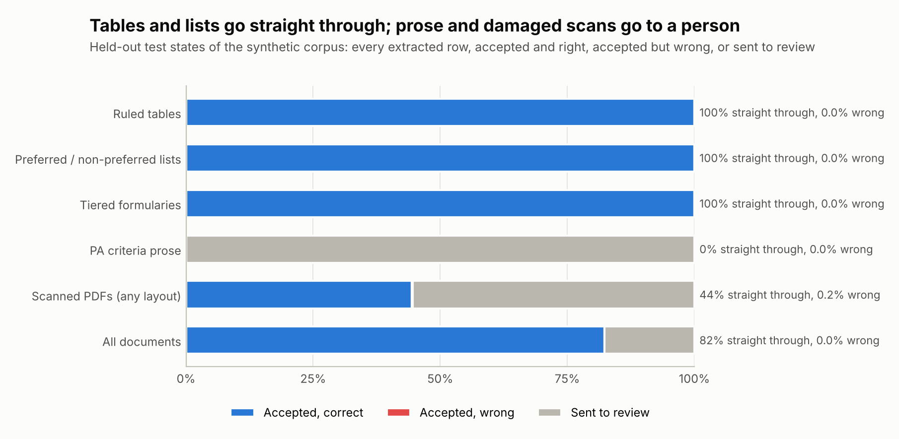

<picture>
  <source media="(prefers-color-scheme: dark)" srcset="assets/banner-dark.svg">
  
</picture>

I'm an AI engineer in Delhi working on pharma commercial and real-world evidence analytics:
prescription and claims data, market access, field force and forecasting, and more and more on
the LLM tools that sit on top of that data.

Most of the projects below come with a simulator or a test set that knows the right answer, so
each README can report how often the method is wrong.

I'm open to AI engineering roles in pharma commercial and RWE analytics.

## Projects

<a href="https://github.com/faizanreza-cs/PDLwatch">
<picture>
  <source media="(prefers-color-scheme: dark)" srcset="assets/logos/pdlwatch-dark.svg">
  
</picture>
</a>

Every state Medicaid program publishes a preferred drug list, each in its own PDF layout, and
market access teams need to know which brands are preferred, which need prior authorization and
what changed since last quarter. PDLwatch reads those PDFs into one table, with the page each
row came from.

It runs every morning on 28 public files from 14 states (56,014 rows). 58% of rows are accepted
automatically and the rest go to a review queue with a reason. In a random check of 60 accepted
rows the status was right in all 60. Earlier checks are how I found the layouts it misread: New
York's step therapy table was being read as part of the drug list, and Utah's two tables per
drug class as two separate lists. Both are fixed. Prior authorization criteria written as
sentences are still hard, so those rows always go to a person.

I also generated 106 synthetic PDFs for all 50 states and DC, where the right answer is known.
In the 26 states held out for testing, 2 of the 5,112 rows it accepted automatically were wrong:

 

<a href="https://github.com/faizanreza-cs/Pharma-MCP">
<picture>
  <source media="(prefers-color-scheme: dark)" srcset="assets/logos/pharma-mcp-dark.svg">
  
</picture>
</a>

An MCP server that gives any MCP client access to openFDA (drug labels, FAERS adverse event
reports, recalls) and ClinicalTrials.gov. The main tool is `signal_check`: give it a drug and a
reaction and it builds the 2×2 table from FAERS counts, then returns PRR and ROR with confidence
intervals and flags the pair using the Evans criteria. FAERS is voluntary reporting, so a flag
means "worth a closer look", not "the drug causes this", and the server tells the model to say so.

 

<a href="https://github.com/faizanreza-cs/PharmaPulse">
<picture>
  <source media="(prefers-color-scheme: dark)" srcset="assets/logos/pharmapulse-dark.svg">
  
</picture>
</a>

Brand analytics on a synthetic US type 2 diabetes market (4 brands, 2,000 HCPs, 12,000
patients, 3 years of weekly data): market share, demand forecasting, Kaplan-Meier persistence,
PDC adherence, HCP targeting and promotional response. ETS forecasts came out best, at 3.1% mean
WAPE on a 13-week holdout. An LLM agent answers questions by calling the same functions as
tools, so the numbers in its answers come from tested code.

### Other projects

-  **[ShelfSense](https://github.com/faizanreza-cs/Shelfsense)**:
  recommendations and review analysis for a supplements store. On 91,227 real Amazon reviews
  the hybrid recommender beat the best single model by 28%.
-  **[Retail Media Lab](https://github.com/faizanreza-cs/Retail-Media-Lab)**:
  Amazon Ads attribution, geo holdouts and a marketing mix model, tested on a simulator that
  knows each channel's true effect. Click-based attribution credited ads with 1.8x the purchases
  they actually caused.
-  **[RAGdesk](https://github.com/faizanreza-cs/Ragdesk)**:
  Q&A over company documents with a citation for each sentence. It says it doesn't know when
  retrieval comes up empty.
-  **[DocFlow Agent](https://github.com/faizanreza-cs/Docflow-agent)**:
  reads invoices, receipts and contracts into structured data, checks the totals, catches
  duplicate invoices and sends anything off to a review queue.
-  **[AgentKit Enterprise](https://github.com/faizanreza-cs/agentkit-enterprise)**:
  guardrails for internal agents: tool permissions per role, human approval for risky actions,
  PII masking and a hash-chained audit log.

## Pharma data I've worked with

| Data | Notes |
|---|---|
| **IQVIA Xponent, PlanTrak, NPA** | Prescriber-level TRx/NRx from Xponent, split by payer plan in PlanTrak; national trend and share from NPA |
| **IQVIA NSP** | Sales into each channel, in units and dollars |
| **IQVIA LAAD, APLD** | Patient-level claims. LAAD includes rejected and reversed claims, which is where abandonment shows up. APLD for journeys, switching and persistence |
| **IntegriChain 867, 852, subnational** | 867 is what wholesalers sold to pharmacies and hospitals, 852 is what they still hold; read together they separate real demand from stocking. Subnational puts those sales at outlet and territory level |
| **Chargebacks** | The difference between WAC and the contract price, claimed back by wholesalers; it shows contract sales by account |
| **Calls, samples, NPP** | Rep calls, sample drops and non-personal promotion, for reach, frequency and promotional response |
| **Roster management** | Who covered which territory and when. Vacancies change how calls and sales should be credited |

## Tools

| | |
|---|---|
| **Languages** | Python, SQL |
| **LLMs** | Claude (Anthropic API), OpenAI, LangChain, MCP, RAG, evals |
| **Data and BI** | pandas, DuckDB, Snowflake, Power BI |
| **Apps** | FastAPI, Streamlit, Docker, GitHub Actions |
| **Stats and ML** | scikit-learn, statsmodels, lifelines, SciPy |
| **Documents** | pdfplumber, Tesseract OCR |
| **Methods** | Forecasting (ETS, gradient boosting), survival analysis, PDC adherence, HCP segmentation, marketing mix models, geo holdouts, disproportionality analysis (PRR, ROR) |
